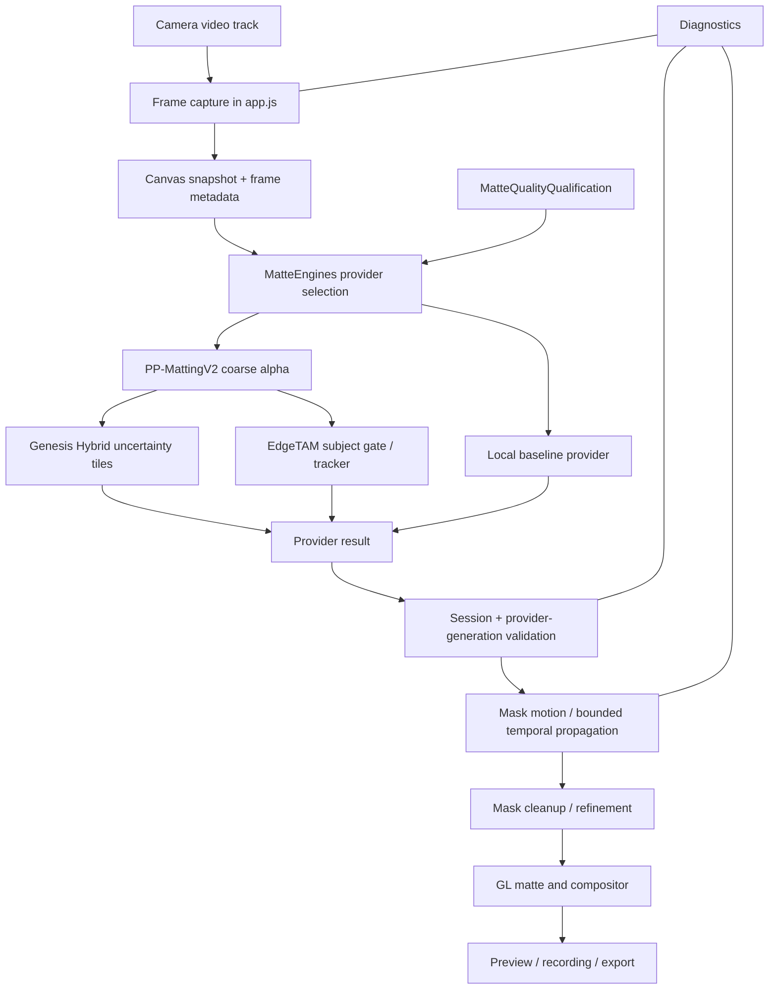

# Genesis final Studio and segmentation execution report

**Execution date:** 26 November 2026  
**Repository:** `HyperNoesis/dawn`  
**Genesis directory:** `genesis/`  
**Continuation branch:** `genesis/final-studio-segmentation-execution`  
**PR:** [#7 — Follow-up to PR #5: quality-qualified segmentation and frame-safe inference](https://github.com/HyperNoesis/dawn/pull/7)  
**PR base:** `segmentation/adaptive-ultramatte-default` at `e01e09e057687048223fdc2cb8d559b83c1e38ac`  
**Original main baseline:** `adb10802c66ab4f58c234063f77cad96779866b4`

## 1. Source of truth and preservation

The uploaded 19-page execution brief was used as the acceptance specification. The live repository, branches, PRs, changed files, workflows and relevant source files were re-read before editing.

- PR #5 remains open/draft and has not been rewritten, merged or force-pushed.
- PR #5's original branch is 143 commits ahead of main and 0 behind.
- A separate continuation branch was created from the exact PR #5 head. PR #7 is based on PR #5, not main; it therefore carries only the incremental follow-up instead of duplicating PR #5's existing 143 commits.
- PR #7 is open, draft, mergeable, 36 commits ahead of its base, and changes 18 Genesis files at the time this report was prepared.
- Neither main nor PR #5 was modified by the continuation work.

## 2. Architecture map

The following is a source-level map of the main code areas inspected. It describes the repository topology; it is not a claim that every path has been physically/device end-to-end verified.

Key source areas inspected include `studio.html`, `js/app.js`, `js/providers/matte-engines.js`, `matte-engine-policy.js`, `quality-governor.js`, `segmentation-flight.js`, `hybrid-provider.js`, `edgetam-provider.js`, `mask-motion.js`, mask cleanup/refinement, diagnostics, the GL matte/composition/render path, model registry, CI workflows and unit/browser gates.

## 3. Implemented changes

### Segmentation correctness and adaptive policy

- Added `js/providers/matte-quality-qualification.js`, a fail-closed registry for PP-MattingV2, Genesis Hybrid and Genesis UltraMatte.
- No experimental route is currently marked approved. Automatic mode retains the established local baseline; explicit BETA/test selection remains available.
- Eligibility requires exact model/version, model hash, preprocessing hash, postprocessing hash and runtime backend identity. PP-MattingV2, Genesis Hybrid and the EdgeTAM-wrapped UltraMatte route now expose canonical runtime identities based on actual loaded weights, source/configuration hashes and the actual ONNX runtime bundle/backend. The model-backed browser gate checks these fields. No experimental route is approved because the independent human-video evidence gate remains unmet.
- Evidence validation requires rights-cleared held-out participant/source-video splits, independent human alpha annotation, paired baseline comparison, no critical-stratum regressions, measurable improvement, benchmark/data manifest hashes, overall sample counts, and all 23 named difficult-scene/hair strata. Each stratum requires its own participant, source-video, clip and annotator counts plus alpha, edge-band, boundary, topology and temporal metrics.
- Automatic candidate selection and the adaptive governor both consult the qualification gate. A timing win cannot independently qualify a route; governor cross-engine switches to unqualified experimental routes are rejected. The active explicitly selected BETA route may still adjust its resolution or fall back to the local baseline.
- UI wording in the engine picker and repository documentation was corrected so Automatic no longer promises timing-only UltraMatte/Hybrid promotion.

### Frame and async lifecycle

- Added monotonically increasing frame IDs and metadata on owned camera-frame canvas snapshots: monotonic capture timestamp, width/height, orientation when available, source video/stream ID and provider-generation ID.
- Added a provider/session generation guard for both synchronous and asynchronous inference. Results from a superseded camera session, provider instance or cache generation are rejected before reaching the compositor.
- Extracted the generation comparison into `js/providers/segmentation-generation.js` and added direct unit coverage for provider replacement, session restart, generation reset and missing state.
- Reset logic clears cached frame identity and detaches stale asynchronous job ownership without allowing an old promise's `finally` handler to clear the state of a newer job.
- Diagnostics now expose captured frame ID/age, dimensions/orientation, provider generation, mask-motion state and Automatic qualification status.

Frame metadata is attached to the app's owned snapshot canvases. This does not mean every video element read in every code path has already been converted to a snapshot packet; complete frame provenance across all direct-video/provider paths remains a verification item.

### Mask motion

- The experimental 150 ms mask-age change was reverted after an existing motion-gap unit asserted the established `frame-gap` result and failed when the shorter age threshold changed the result to `stale-mask`.
- The existing 1,500 ms maximum age remains in place. It is provisional, not certified; it must be calibrated with representative motion clips and target devices rather than selected by intuition.
- The existing mask-motion unit was preserved; no test was weakened to conceal the failed experiment.

### Documentation and release evidence

- Added `GENESIS_SEGMENTATION_QUALIFICATION.md`, `GENESIS_STUDIO_ACCEPTANCE_MATRIX.md` and this report.
- Updated README, DEPLOY, LICENSES, NEXT, MASTER_ROADMAP, adaptive segmentation changelog and DEVICE_MATRIX so old timing-only Automatic claims and unmeasured device claims are not treated as current truth.
- Recorded actual synthetic CI observations separately from human-video qualification evidence.
- No estimated physical-device measurements or invented human-video scores were added.

## 4. Defect and risk ledger

| Priority | Finding | Disposition |
|---|---|---|
| P1 | Automatic candidate promotion could be based on initialization/performance without an independent quality qualification | FIXED in policy; all experimental routes currently UNQUALIFIED |
| P1 | A result could outlive a provider swap within the same camera session | FIXED with provider/session generation guard and pure unit regression |
| P1 | Adaptive governor could cross-switch between experimental routes without a route-quality check | FIXED with registered-qualification and runtime identity checks |
| P1 | No complete rights-cleared, independent human-labelled video benchmark exists in the checked repository evidence | BLOCKED — data/consent/annotation required |
| P1 | No filled physical-device matrix for target Android/iOS/desktop profiles | BLOCKED — actual device sessions required |
| P1 | Runtime providers did not expose canonical qualification identity for all model/pre/postprocess/backend components | FIXED — identity helper and all three provider routes integrated; unit and model-backed browser assertions PASS on 8bfffcb |
| P1 | RVM GPL-3.0 code/model assets remain in the publicly served browser repository | LEGAL REVIEW / packaging decision required before a closed-source paid distribution |
| P2 | Synthetic camera gate's minimum FPS threshold is too weak to demonstrate smooth creator experience | EVIDENCE GAP — test passes while measured synthetic sample rate is only 3.47 FPS |
| P2 | Camera startup and post-settle measurements differ substantially | DOCUMENTED — the gate captures the first stats string immediately after Start, then captures app stats after a 3-second scene settle and the sample window; these are different times, not contradictory simultaneous readings |
| P2 | Final Studio render matte has higher transition-band error than raw alpha in the synthetic fixture | OPEN RESEARCH/FIX — inspect renderer edge/decontamination path with real labels before changing defaults |
| P2 | Full 17-tab Studio feature journeys, screen-reader, reduced-motion and physical-touch audit not executed | PARTIAL — 17/17 shell panels, ARIA/keyboard navigation and 360/768/1440 px overflow smoke PASS; internal workflows and assistive-tech/device checks NOT RUN |
| P2 | Legacy shared CSS / inline-style migration lacks selector map and screenshot diffs | NOT RUN — no blind CSS deletion performed |
| P2 | Full current repository secret/dependency/security scan not re-run in this execution | NOT RUN — do not infer a clean security audit from prior documentation |

## 5. Automated validation

### Full segmentation CI on the pre-helper code head

GitHub Actions run [45847956492](https://github.com/HyperNoesis/dawn/actions/runs/45847956492), commit `a46fd4c545418fe6216edba4c565b98d2d50e692`: **PASS**.

| Workflow step | Result |
|---|---|
| Restore required model/runtime binaries | PASS |
| Fetch checksum-verified PP-MattingV2 and EdgeTAM models | PASS |
| Install Python test dependencies | PASS |
| Protected signalling/render service tests | PASS |
| Browser/worker/build/server JavaScript syntax | PASS |
| Provider and pure-logic unit suites | PASS |
| Playwright and Chromium install | PASS |
| Camera/model/motion/matte-edge browser gates | PASS |
| Export safety and API regression suites | PASS |
| Deployable PWA site build | PASS |
| Gate artifact upload | PASS |

That earlier run was superseded by current-head segmentation workflow [45908860131](https://github.com/HyperNoesis/dawn/actions/runs/45908860131) on commit `8bfffcb3585bdad8c63eb5d5a13674c28423a7c8`; all its required steps, including the provider/pure-logic unit suites, Studio shell test, model-backed browser gates, export/API suite and site build, completed successfully.

### Android

- Android debug build run [45846264841](https://github.com/HyperNoesis/dawn/actions/runs/45846264841): **PASS** on the earlier continuation head `0c4f9d3e13c58d260645465352927f6b9cae49c7`.
- This was a debug APK build only. Signed release was skipped.
- The final helper/loader changes and latest docs are newer than that Android build. No final-head Android rebuild or physical install is claimed.

### Artifact observations from run 45847956492

The CI artifact `genesis-segmentation-gate-report` was downloaded and inspected. It contains a generated synthetic fixture, not real human media.

| Metric | Observed value |
|---|---:|
| UltraMatte initialization | 2,495 ms |
| UltraMatte segmentation P50 | 464 ms |
| UltraMatte segmentation P75 | 602 ms |
| UltraMatte segmentation P95 / max | 2,790 ms |
| Estimated mask updates/s at P75 | 1.66 |
| Raw synthetic alpha MAE | 0.00456 at 512×384 (native provider resolution) |
| Final Studio synthetic alpha MAE | 0.00433 at 640×480 (output resolution) |
| Raw transition-band MAE | 0.18079 at 512×384 (native provider resolution) |
| Final Studio transition-band MAE | 0.34012 at 640×480 (output resolution) |
| Raw / final foreground IoU | 0.98449 / 0.98340 at different resolutions |
| Separate generic camera-gate sample rate | 3.47 FPS |

**Important benchmark correction (27 November):** the historical raw-provider metrics above were scored at 512×384, while the final Studio metrics were scored at 640×480. Those pairs are not a valid like-for-like comparison and must not be used to conclude that the compositor worsens alpha edges. The current t50_ultramatte_gate.js now reports raw native-resolution quality separately, then resizes the raw provider mask to the exact final output dimensions and compares that result against the final Studio alpha at the same dimensions. The corrected run is pending; no new compositor-regression conclusion is claimed yet. Transition-band MAE is computed on reference-alpha pixels between 8 and 247, normalised by 255; foreground IoU uses a threshold of 127.

The UltraMatte test uses `tools/e2e/fixtures/gt_alpha_640x480.png`, explicitly described by the test as synthetic labelled fixture only. Its output shows a generated cartoon presenter. It cannot establish natural hair, transparent cloth, fingers, occlusion, backlight or multi-person quality.

The generic camera gate sampled 28 frames in 8.07 seconds, about 3.47 FPS. Its script captures the first stats string immediately after camera Start (0 FPS / 1,495 ms during startup), then changes the scene, waits 3 seconds, samples the preview, and captures the later app stats (about 4 FPS / 375 ms). Those are different sampling moments, not contradictory simultaneous readings. The 8.07-second sampled preview rate is still far below the brief's 24 FPS target intent; these are synthetic Chromium results, not phone performance.

## 6. Studio functional and visual status

The live Studio shell exposes 17 tool tabs. A source inventory and acceptance matrix were added, but the complete journeys have not all been re-run. In the matrix:
- the mask/diagnostics flow is PARTIAL because the new policy/metadata is integrated but not every interaction is end-to-end validated;
- Go Live is BLOCKED without a configured WHIP endpoint and credentials;
- physical camera failure, long recording and real export playback require real browser/device sessions;
- most remaining tabs and journeys are NOT RUN, not passed by inference from visible controls.

The repository already has a multicolour Genesis design-token system (purple brand/action, cyan intelligence, amber/warning, green success and semantic error/focus roles). The shared system stylesheet is approximately 263 KB, while `studio.html` contains roughly 214 inline style attributes and one small inline style block. No wide CSS retirement was attempted without a selector/dependency map and desktop/tablet/phone screenshot diffs. The accessibility/responsive visual pass remains open.

## 7. Privacy, security, model rights and packaging

- The execution retained the existing local-camera architecture; no user frames, recordings or API secrets were uploaded by this work.
- Protected signalling/render service tests passed in the full CI run. This is not a complete repository security review.
- A current full secret scan, upload/polyglot fuzz pass and complete dependency vulnerability review were not executed here.
- Registry/licence documentation identifies PP-MattingV2 and EdgeTAM as Apache-2.0, but training data provenance/terms still require legal review before commercial claims.
- RVM's GPL-3.0 code/model files remain in the browser distribution. Excluding RVM from Automatic does not remove those files from a paid/closed-source distribution; resolve the licence/distribution plan first.
- BiRefNet training-data rights remain unresolved. MatAnyone 2 and SAM2Matting are non-commercial and must not be placed in a paid route.
- The PWA site build passed on current-head run 45908860131. Android debug packaging passed on current-head run 45908860172; signed release was skipped. No physical installation, signed release or deployment occurred.

## 8. Physical-device and real-footage acceptance

All rows remain **BLOCKED** pending actual sessions and reports: Redmi 14C, low-end Android 2–3 GB, flagship Android, iPhone Safari, Windows integrated GPU and MacBook.

The following are not certified: phone FPS/P50/P75/P95, displayed mask age, thermal throttling, memory plateau, battery drain, camera lifecycle, sustained 10–30 minute recording, real hair/finger/fabric cutouts and camera switching/orientation resilience.

The real-video dataset must be rights-cleared and commercially permitted for the intended use, split by participant and source clip, independently alpha-annotated, and stratified across all 23 required categories. Synthetic samples, P3M research-only stills, online photos and teacher-model agreement do not substitute for that evidence.

## 9. Release verdict

**Status: NOT PRODUCTION-READY.** The executable-code head `8bfffcb3585bdad8c63eb5d5a13674c28423a7c8` has a green full segmentation CI run, green Android debug packaging, a passing Studio shell smoke test and a passing model-backed synthetic integration gate. The independent real-human video evidence, physical-device matrix, end-to-end Studio feature journeys, legal review and complete security review are still outstanding.

The experimental segmentation routes remain BETA and are not automatically promoted. The current synthetic UltraMatte run measured P75 611 ms per segment (~1.64 mask updates/s) and P95/max 2,629 ms. Mean synthetic transition-band error increased from 0.18545 on raw alpha to 0.33888 after the final Studio compositor; diagnostic edge settings improve that synthetic metric but have not been promoted. The Studio shell smoke passes, but full tool workflows, screen-reader/reduced-motion/touch checks, physical target-device matrix, legal review and comprehensive security scan remain open. Current-head Android debug packaging passed; no signed release or device install occurred.

No merge, production deploy, payment/paid-service activation, signing or release action was performed. Keep PR #7 in draft until its latest CI is green and the external evidence/legal/device gates are completed.

## Additional correctness hardening — 26 November 2026

- Added executable quality thresholds for both aggregate metrics and each of the 23 strata: alpha MAD ≤ 0.05, edge-band MAD ≤ 0.08, boundary F1 ≥ 0.90, topology error ≤ 0.05 and temporal delta MAE ≤ 0.05. These are explicit v1 engineering acceptance limits, not claimed measurements; P95 latency remains device-specific.
- Added regression cases proving complete evidence metadata cannot approve poor alpha or boundary scores, and pinned the threshold values in tests.
- Found and fixed an additional asynchronous race in `backgroundUpgrade`: a long model download/benchmark could otherwise overwrite a provider selected by the user or governor during the same camera session. The stale check now binds the candidate to the original provider instance and provider generation as well as the camera session token.
- Latest source commit: `35e371ba18b2283c684526d174b214afcc656906`. CI for the preceding quality-gate/test commit was still running when this report was updated; the provider-race fix requires a fresh latest-head regression run.

## Current-head verification and artifact review — 26 November 2026

**Executable-code commit tested:** `8bfffcb3585bdad8c63eb5d5a13674c28423a7c8`.

- Segmentation workflow [45908860131](https://github.com/HyperNoesis/dawn/actions/runs/45908860131): **SUCCESS**. Passed dependency/model restoration, protected service tests, JS syntax, provider and pure-logic units, Studio shell navigation/responsive smoke, camera/model/motion/matte-edge browser gates (including real loaded PP-MattingV2 + EdgeTAM identity), export/API regressions and deployable PWA site build.
- Android workflow [45908860172](https://github.com/HyperNoesis/dawn/actions/runs/45908860172): **SUCCESS** for debug APK packaging. Test-only APK artifact uploaded; signed-release check **SKIPPED**. No APK was installed on a physical phone.
- Segmentation report artifact `genesis-segmentation-gate-report`, artifact ID `15159048796`, inspected locally. Studio output includes 17 panel screenshots, 3 responsive screenshots, `studio-shell-smoke.json`, camera gate report and UltraMatte gate report.

### New executable identity path

Added `js/providers/matte-qualification-identity.js`. PP-MattingV2 now fingerprints actual loaded model bytes, registry version, processing code/configuration and ONNX runtime resources. Genesis Hybrid composes its own tile/refinement source and settings into that identity. The EdgeTAM wrapper includes its exact loaded encoder/decoder assets and tracker/refinement code. Runtime backend and actual ONNX JavaScript/WASM bundle are captured; CDN or unidentifiable runtime fallback cannot be used for automatic qualification. The app awaits the identity before the qualification gate. Unit coverage checks hash changes, provider composition, EdgeTAM runtime source and policy dependencies. The t50 browser test validates the fully initialized route and writes the observed identity into its artifact.

### Artifact observations — synthetic fixtures only

| Measurement | Current artifact observation |
|---|---:|
| Generic synthetic camera sample | 36 frames / 8.01 s = 4.49 FPS |
| Generic later in-app stats | 5 FPS; 186 ms frame latency |
| UltraMatte initialisation | 2,513 ms |
| UltraMatte segment P50 / P75 | 475 ms / 611 ms |
| UltraMatte segment P95 / max | 2,629 ms / 2,629 ms |
| Estimated updates/s at P75 | 1.64 |
| Mean raw synthetic alpha MAE | 0.00542 |
| Mean final Studio synthetic alpha MAE | 0.00523 |
| Mean raw transition-band error | 0.18545 |
| Mean final Studio transition-band error | 0.33888 |
| Mean diagnostic edge A/B transition-band error | 0.30356 / 0.27792 |

Across ten synthetic frames the Hybrid scheduler reported 16 tile attempts, 9 refined, 20 deferred, 33 cached, 7 rejected and zero errors. These counts are scheduler diagnostics, not a quality score. Final Studio compositing reduced overall synthetic alpha MAE slightly but increased transition-band error substantially; the edge A/B settings reduce that synthetic boundary error but are not production defaults. The fixture is a generated/cartoon presenter, not a consented human video.

### Studio shell artifact

The new Playwright test verified all 17 tabs, visible panel activation, ARIA relationships, keyboard Arrow/Home/End navigation and no horizontal overflow at 360×800, 768×1024 and 1440×900. It recorded zero page errors, console errors, failed local requests or local HTTP errors. Its screenshots and report are in the CI artifact. This does not validate the complete feature journeys within every panel, screen readers, reduced motion or real phone touch behaviour.

### Remaining release blockers

1. A rights-cleared, consented, independently alpha-annotated held-out human-video evaluation with results for all 23 required strata and paired baseline comparisons is still absent.
2. The synthetic UltraMatte speed is far below the 24 FPS live objective, and final-compositor transition-band error needs further investigation with human-labelled edges.
3. No physical-device performance/stability reports exist for the Redmi 14C, other Android tiers, iOS Safari, Windows GPU or Mac.
4. Full end-to-end Studio workflows, camera lifecycle failure cases, long recording and media playback, screen-reader/reduced-motion and touch usability remain unverified.
5. RVM GPL-3.0 distribution, model/training-data terms and BiRefNet data rights require legal review; MatAnyone 2/SAM2Matting remain excluded from paid paths.
6. No comprehensive secret scan, dependency vulnerability review or complete repository security assessment was executed. Protected signalling/render tests and a limited GitHub code search are not a substitute.
7. PR #7 remains a draft, open and unmerged. No deployment, paid service activation, signing or production release was performed.

**Release decision remains unchanged: NOT PRODUCTION-READY.** The runtime identity integration is fixed and tested; the evidence-based quality decision is still BLOCKED.

## Additional execution hardening — 27 November 2026

### Runtime identity and adaptive promotion
- The qualification identity now includes EdgeTAM's effective ONNX Runtime WASM thread count and proxy mode. ort-loader.js explicitly configures the effective thread count (including the single-thread non-isolated fallback) so the identity is not based on an implicit runtime default.
- Automatic experimental routes now revalidate their exact identity even on a same-engine governor restart. Cross-engine governor transitions continue to require identity checks. Automatic mode also refuses to restore a saved experimental resolution rung that could bypass the qualified rung.
- The provider-generation and quality-gate regression suites cover the automatic restart, cross-engine, explicit-BETA and baseline cases.

### Frame ownership and lifecycle
- Removed every live-video fallback from segmentation inference and candidate benchmarking when immutable frame capture fails. A failed asynchronous snapshot invalidates the cached matte and frame identity, then passes the camera through until a fresh valid mask is available.
- Added a bounded frame snapshot canvas pool (one reusable canvas up to 1080p). The person-image decode holds its own frame lease, so a canvas cannot be recycled while either inference or bitmap decoding still reads it.
- Added tests for pool reuse, maximum retained canvases, oversized-canvas release, double release, simultaneous frame isolation, and snapshot-failure behavior.
- Worker request timeouts and provider disposal reject pending work and release associated frame leases instead of leaving promises and buffers indefinitely pending.

### Alpha pipeline and measurement
- The compositor preserves fractional alpha for matting providers; the semantic MediaPipe mask keeps its separate thresholding behavior. Provider swaps update the compositor state, and the qualification identity includes the alpha-preservation configuration.
- The synthetic matte benchmark now separates native provider-resolution alpha from raw alpha resized to final output resolution. Raw-versus-final compositor metrics are compared only at the same dimensions.
- The corrected benchmark run is not yet complete, so no new edge-quality conclusion is claimed.

### Offline shell and Studio verification
- Bumped the service-worker shell cache to genesis-shell-v147.
- Added all provider JavaScript files and all local script/stylesheet dependencies referenced by studio.html to the precache manifest. The shell manifest contains 258 assets; a repository-tree audit found no missing paths.
- Added a regression test that checks every provider JS file, every local Studio script/link dependency, and every shell-manifest path exists in the repository.
- Strengthened the Studio shell smoke test to require exactly one active panel and zero visible inactive panels after each tab selection, in addition to ARIA, keyboard and responsive checks.
- A static CSS inventory of genesis/css/genesis-system.css found 2,278 rule blocks, 1,797 unique selectors, 302 selectors repeated across the cascade, 710 !important occurrences, 105 media-query blocks and 308 custom properties. studio.html contains 214 inline style attributes and no inline event-handler attributes. This is an inventory, not a dead-code verdict: duplicate selectors and inline styles may be intentional/dynamic. Broad CSS deletion remains blocked until dependency mapping and screenshot diffs are available.

### Current-head validation snapshot
- Full segmentation workflow run 45959480952 passed all steps on head 50032dc84628080cce23677f288c73c3858bb565, including provider/pure-logic tests, Studio shell smoke, camera/model/motion/matte-edge browser gates, export/API regressions and deployable-site build.
- The newer head 33c198db59454394ba2075d8ba31ff6b39125322 includes the same-resolution benchmark correction. Its provider/pure-logic unit suite and strengthened Studio shell smoke have passed; the camera/model/motion/matte-edge browser gate is still running at the time of this report update. Do not treat that newer head as fully green until the workflow completes.
- The current branch remains PR #7, open and draft. No merge, production deploy, signed release, paid activation or physical-device validation has been performed.
