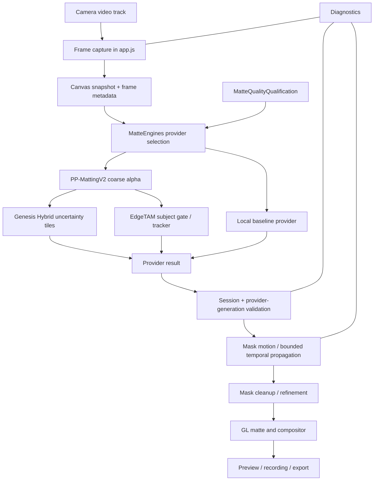

# Genesis final Studio and segmentation execution report

**Execution date:** 26 November 2026  
**Repository:** `HyperNoesis/dawn`  
**Genesis directory:** `genesis/`  
**Continuation branch:** `genesis/final-studio-segmentation-execution`  
**PR:** [#7 — Follow-up to PR #5: quality-qualified segmentation and frame-safe inference](https://github.com/HyperNoesis/dawn/pull/7)  
**PR base:** `segmentation/adaptive-ultramatte-default` at `e01e09e057687048223fdc2cb8d559b83c1e38ac`  
**Original main baseline:** `adb10802c66ab4f58c234063f77cad96779866b4`

## 1. Source of truth and preservation

The uploaded 19-page execution brief was used as the acceptance specification. The live repository, branches, PRs, changed files, workflows and relevant source files were re-read before editing.

- PR #5 remains open/draft and has not been rewritten, merged or force-pushed.
- PR #5's original branch is 143 commits ahead of main and 0 behind.
- A separate continuation branch was created from the exact PR #5 head. PR #7 is based on PR #5, not main; it therefore carries only the incremental follow-up instead of duplicating PR #5's existing 143 commits.
- PR #7 is open, draft, mergeable, 36 commits ahead of its base, and changes 18 Genesis files at the time this report was prepared.
- Neither main nor PR #5 was modified by the continuation work.

## 2. Architecture map

The following is a source-level map of the main code areas inspected. It describes the repository topology; it is not a claim that every path has been physically/device end-to-end verified.

Key source areas inspected include `studio.html`, `js/app.js`, `js/providers/matte-engines.js`, `matte-engine-policy.js`, `quality-governor.js`, `segmentation-flight.js`, `hybrid-provider.js`, `edgetam-provider.js`, `mask-motion.js`, mask cleanup/refinement, diagnostics, the GL matte/composition/render path, model registry, CI workflows and unit/browser gates.

## 3. Implemented changes

### Segmentation correctness and adaptive policy

- Added `js/providers/matte-quality-qualification.js`, a fail-closed registry for PP-MattingV2, Genesis Hybrid and Genesis UltraMatte.
- No experimental route is currently marked approved. Automatic mode retains the established local baseline; explicit BETA/test selection remains available.
- Eligibility requires exact model/version, model hash, preprocessing hash, postprocessing hash and runtime backend identity. A provider must expose a runtime identity that matches its registered qualification. The current providers do not yet expose a complete canonical identity, so they cannot pass the gate even if someone were to add an incomplete entry.
- Evidence validation requires rights-cleared held-out participant/source-video splits, independent human alpha annotation, paired baseline comparison, no critical-stratum regressions, measurable improvement, benchmark/data manifest hashes, overall sample counts, and all 23 named difficult-scene/hair strata. Each stratum requires its own participant, source-video, clip and annotator counts plus alpha, edge-band, boundary, topology and temporal metrics.
- Automatic candidate selection and the adaptive governor both consult the qualification gate. A timing win cannot independently qualify a route; governor cross-engine switches to unqualified experimental routes are rejected. The active explicitly selected BETA route may still adjust its resolution or fall back to the local baseline.
- UI wording in the engine picker and repository documentation was corrected so Automatic no longer promises timing-only UltraMatte/Hybrid promotion.

### Frame and async lifecycle

- Added monotonically increasing frame IDs and metadata on owned camera-frame canvas snapshots: monotonic capture timestamp, width/height, orientation when available, source video/stream ID and provider-generation ID.
- Added a provider/session generation guard for both synchronous and asynchronous inference. Results from a superseded camera session, provider instance or cache generation are rejected before reaching the compositor.
- Extracted the generation comparison into `js/providers/segmentation-generation.js` and added direct unit coverage for provider replacement, session restart, generation reset and missing state.
- Reset logic clears cached frame identity and detaches stale asynchronous job ownership without allowing an old promise's `finally` handler to clear the state of a newer job.
- Diagnostics now expose captured frame ID/age, dimensions/orientation, provider generation, mask-motion state and Automatic qualification status.

Frame metadata is attached to the app's owned snapshot canvases. This does not mean every video element read in every code path has already been converted to a snapshot packet; complete frame provenance across all direct-video/provider paths remains a verification item.

### Mask motion

- The experimental 150 ms mask-age change was reverted after an existing motion-gap unit asserted the established `frame-gap` result and failed when the shorter age threshold changed the result to `stale-mask`.
- The existing 1,500 ms maximum age remains in place. It is provisional, not certified; it must be calibrated with representative motion clips and target devices rather than selected by intuition.
- The existing mask-motion unit was preserved; no test was weakened to conceal the failed experiment.

### Documentation and release evidence

- Added `GENESIS_SEGMENTATION_QUALIFICATION.md`, `GENESIS_STUDIO_ACCEPTANCE_MATRIX.md` and this report.
- Updated README, DEPLOY, LICENSES, NEXT, MASTER_ROADMAP, adaptive segmentation changelog and DEVICE_MATRIX so old timing-only Automatic claims and unmeasured device claims are not treated as current truth.
- Recorded actual synthetic CI observations separately from human-video qualification evidence.
- No estimated physical-device measurements or invented human-video scores were added.

## 4. Defect and risk ledger

| Priority | Finding | Disposition |
|---|---|---|
| P1 | Automatic candidate promotion could be based on initialization/performance without an independent quality qualification | FIXED in policy; all experimental routes currently UNQUALIFIED |
| P1 | A result could outlive a provider swap within the same camera session | FIXED with provider/session generation guard and pure unit regression |
| P1 | Adaptive governor could cross-switch between experimental routes without a route-quality check | FIXED with registered-qualification and runtime identity checks |
| P1 | No complete rights-cleared, independent human-labelled video benchmark exists in the checked repository evidence | BLOCKED — data/consent/annotation required |
| P1 | No filled physical-device matrix for target Android/iOS/desktop profiles | BLOCKED — actual device sessions required |
| P1 | Runtime providers do not yet expose canonical qualification identity for all model/pre/postprocess/backend components | BLOCKED — no experimental route can be automatically approved yet |
| P1 | RVM GPL-3.0 code/model assets remain in the publicly served browser repository | LEGAL REVIEW / packaging decision required before a closed-source paid distribution |
| P2 | Synthetic camera gate's minimum FPS threshold is too weak to demonstrate smooth creator experience | EVIDENCE GAP — test passes while measured synthetic sample rate is only 3.47 FPS |
| P2 | Camera startup and post-settle measurements differ substantially | DOCUMENTED — the gate captures the first stats string immediately after Start, then captures app stats after a 3-second scene settle and the sample window; these are different times, not contradictory simultaneous readings |
| P2 | Final Studio render matte has higher transition-band error than raw alpha in the synthetic fixture | OPEN RESEARCH/FIX — inspect renderer edge/decontamination path with real labels before changing defaults |
| P2 | Full 17-tab Studio journey, keyboard, screen-reader and responsive audit not executed | NOT RUN / BLOCKED by lack of full browser/device session |
| P2 | Legacy shared CSS / inline-style migration lacks selector map and screenshot diffs | NOT RUN — no blind CSS deletion performed |
| P2 | Full current repository secret/dependency/security scan not re-run in this execution | NOT RUN — do not infer a clean security audit from prior documentation |

## 5. Automated validation

### Full segmentation CI on the pre-helper code head

GitHub Actions run [45847956492](https://github.com/HyperNoesis/dawn/actions/runs/45847956492), commit `a46fd4c545418fe6216edba4c565b98d2d50e692`: **PASS**.

| Workflow step | Result |
|---|---|
| Restore required model/runtime binaries | PASS |
| Fetch checksum-verified PP-MattingV2 and EdgeTAM models | PASS |
| Install Python test dependencies | PASS |
| Protected signalling/render service tests | PASS |
| Browser/worker/build/server JavaScript syntax | PASS |
| Provider and pure-logic unit suites | PASS |
| Playwright and Chromium install | PASS |
| Camera/model/motion/matte-edge browser gates | PASS |
| Export safety and API regression suites | PASS |
| Deployable PWA site build | PASS |
| Gate artifact upload | PASS |

The same complete test run predates the final extraction of the provider-generation predicate into a shared helper and its dedicated unit test. That helper/test change is present on the latest branch and a fresh full CI run is queued/in progress; it must complete successfully before treating the latest head as fully validated.

### Android

- Android debug build run [45846264841](https://github.com/HyperNoesis/dawn/actions/runs/45846264841): **PASS** on the earlier continuation head `0c4f9d3e13c58d260645465352927f6b9cae49c7`.
- This was a debug APK build only. Signed release was skipped.
- The final helper/loader changes and latest docs are newer than that Android build. No final-head Android rebuild or physical install is claimed.

### Artifact observations from run 45847956492

The CI artifact `genesis-segmentation-gate-report` was downloaded and inspected. It contains a generated synthetic fixture, not real human media.

| Metric | Observed value |
|---|---:|
| UltraMatte initialization | 2,495 ms |
| UltraMatte segmentation P50 | 464 ms |
| UltraMatte segmentation P75 | 602 ms |
| UltraMatte segmentation P95 / max | 2,790 ms |
| Estimated mask updates/s at P75 | 1.66 |
| Raw synthetic alpha MAE | 0.00456 |
| Final Studio synthetic alpha MAE | 0.00433 |
| Raw transition-band MAE | 0.18079 |
| Final Studio transition-band MAE | 0.34012 |
| Raw / final foreground IoU | 0.98449 / 0.98340 |
| Separate generic camera-gate sample rate | 3.47 FPS |

The transition-band MAE is computed on fixture pixels whose reference alpha is between 8 and 247, normalised by 255; foreground IoU uses a threshold of 127. The diagnostic edge parameter experiments gave 0.30514 and 0.27887 transition-band MAE, but they are synthetic A/B measurements only and were not promoted to production settings.

The UltraMatte test uses `tools/e2e/fixtures/gt_alpha_640x480.png`, explicitly described by the test as synthetic labelled fixture only. Its output shows a generated cartoon presenter. It cannot establish natural hair, transparent cloth, fingers, occlusion, backlight or multi-person quality.

The generic camera gate sampled 28 frames in 8.07 seconds, about 3.47 FPS. Its script captures the first stats string immediately after camera Start (0 FPS / 1,495 ms during startup), then changes the scene, waits 3 seconds, samples the preview, and captures the later app stats (about 4 FPS / 375 ms). Those are different sampling moments, not contradictory simultaneous readings. The 8.07-second sampled preview rate is still far below the brief's 24 FPS target intent; these are synthetic Chromium results, not phone performance.

## 6. Studio functional and visual status

The live Studio shell exposes 17 tool tabs. A source inventory and acceptance matrix were added, but the complete journeys have not all been re-run. In the matrix:
- the mask/diagnostics flow is PARTIAL because the new policy/metadata is integrated but not every interaction is end-to-end validated;
- Go Live is BLOCKED without a configured WHIP endpoint and credentials;
- physical camera failure, long recording and real export playback require real browser/device sessions;
- most remaining tabs and journeys are NOT RUN, not passed by inference from visible controls.

The repository already has a multicolour Genesis design-token system (purple brand/action, cyan intelligence, amber/warning, green success and semantic error/focus roles). The shared system stylesheet is approximately 263 KB, while `studio.html` contains roughly 214 inline style attributes and one small inline style block. No wide CSS retirement was attempted without a selector/dependency map and desktop/tablet/phone screenshot diffs. The accessibility/responsive visual pass remains open.

## 7. Privacy, security, model rights and packaging

- The execution retained the existing local-camera architecture; no user frames, recordings or API secrets were uploaded by this work.
- Protected signalling/render service tests passed in the full CI run. This is not a complete repository security review.
- A current full secret scan, upload/polyglot fuzz pass and complete dependency vulnerability review were not executed here.
- Registry/licence documentation identifies PP-MattingV2 and EdgeTAM as Apache-2.0, but training data provenance/terms still require legal review before commercial claims.
- RVM's GPL-3.0 code/model files remain in the browser distribution. Excluding RVM from Automatic does not remove those files from a paid/closed-source distribution; resolve the licence/distribution plan first.
- BiRefNet training-data rights remain unresolved. MatAnyone 2 and SAM2Matting are non-commercial and must not be placed in a paid route.
- The PWA site build passed on run 45847956492. Current-head Android packaging remains to be repeated; no signed production release or deployment occurred.

## 8. Physical-device and real-footage acceptance

All rows remain **BLOCKED** pending actual sessions and reports: Redmi 14C, low-end Android 2–3 GB, flagship Android, iPhone Safari, Windows integrated GPU and MacBook.

The following are not certified: phone FPS/P50/P75/P95, displayed mask age, thermal throttling, memory plateau, battery drain, camera lifecycle, sustained 10–30 minute recording, real hair/finger/fabric cutouts and camera switching/orientation resilience.

The real-video dataset must be rights-cleared and commercially permitted for the intended use, split by participant and source clip, independently alpha-annotated, and stratified across all 23 required categories. Synthetic samples, P3M research-only stills, online photos and teacher-model agreement do not substitute for that evidence.

## 9. Release verdict

**Status: NOT PRODUCTION-READY.** The repository has a successfully tested PWA build and a full green synthetic/integration CI run on the earlier code head, and the continuation implements important policy/frame-lifecycle safeguards. The latest helper changes require the queued current-head CI to finish.

The experimental segmentation routes remain BETA and are not automatically promoted. Their measured synthetic CI speed is far below a 24 FPS live intent, and their quality remains unqualified for natural human footage. The Studio's full 17-tab workflows, physical target-device matrix, legal review, security scan and current-head Android packaging remain open.

No merge, production deploy, payment/paid-service activation, signing or release action was performed. Keep PR #7 in draft until its latest CI is green and the external evidence/legal/device gates are completed.
